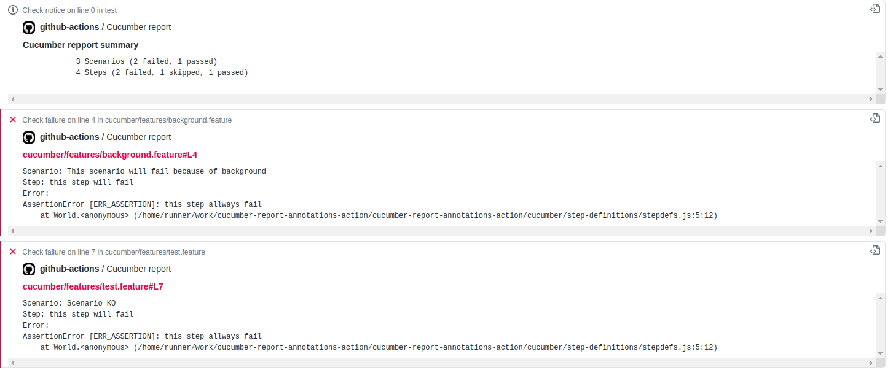

# Cucumber Report Annotations Action

This GitHub Action publishes action annotations from Cucumber reports.

## Example

```yaml
- uses: deblockt/cucumber-report-annotations-action@v1.7
  with:
    access-token: ${{ secrets.GITHUB_TOKEN }}
    path: "**/cucumber-report.json"
```



## Where the results are published

The action publishes the results in two places:

- **A check run**, named after the `name` input, with one annotation per failed step (and per undefined or pending step when `annotation-status-on-undefined` or `annotation-status-on-pending` is set). With `show-global-summary-report`, it also gets one annotation per feature file listing its scenarios. On a pull request, the check is in the **Checks** tab and the annotations are shown in **Files changed** on the feature files modified by the pull request.
- **The job summary**, on the workflow run page. It contains the scenario and step counts, the details of the steps in error (scenario, step, error and a link to the feature file), and the report of each feature file when `show-global-summary-report` is set. At most 100 steps are detailed per report.

GitHub does not allow attaching a check run created through the API to the workflow run that created it: on a `push` or a `workflow_dispatch`, the check run can appear under any workflow run of the same commit. The job summary is always attached to the job running the action.

## Supported Formats

This GitHub Action supports two formats:

- **JSON**: The deprecated Cucumber report format. Prefer using the message format. If you use this format, the file extension should be `.json`.
- **Message**: The new Cucumber report format using NDJSON (newline-delimited JSON). If you use this format, the file extension should be `.ndjson`.

## Parameters

All parameters in this action are optional, allowing flexibility in configuration based on your needs.

| **Input Name**                          | **Description**                                                                         | **Default**               | **Options**                     |
|-----------------------------------------|-----------------------------------------------------------------------------------------|---------------------------|---------------------------------|
| **access-token**                        | GitHub token.                                                                           | `${{ github.token }}`     |                                 |
| **path**                                | Glob pattern to locate Cucumber JSON files.                                             | `**/cucumber-report.json` |                                 |
| **name**                                | The name of the check.                                                                  | `Cucumber report`         |                                 |
| **check-status-on-error**               | Check status for Cucumber errors.                                                       | `failure`                 | `success`, `neutral`, `failure` |
| **check-status-on-undefined**           | Check status for undefined steps.                                                       | `success`                 | `success`, `neutral`, `failure` |
| **check-status-on-pending**             | Check status for pending steps.                                                         | `success`                 | `success`, `neutral`, `failure` |
| **annotation-status-on-error**          | Annotation status for errors.                                                           | `failure`                 | `notice`, `warning`, `failure`  |
| **annotation-status-on-undefined**      | Annotation status for undefined steps. No annotation if not set.                        |                           | `notice`, `warning`, `failure`  |
| **annotation-status-on-pending**        | Annotation status for pending steps. No annotation if not set.                          |                           | `notice`, `warning`, `failure`  |
| **show-number-of-error-on-check-title** | Show the number of errors in the check title (visible in PR checks).                    | `true`                    | `true`, `false`                 |
| **show-global-summary-report**          | Display a report of the scenarios of each feature file, in the check annotations and in the job summary. | `false`                   | `true`, `false`                 |
| **number-of-test-error-to-fail-job**    | Number of test errors required to fail the build. Undefined and pending steps count as errors when an annotation is created for them (`annotation-status-on-undefined`, `annotation-status-on-pending`). <br> `-1` prevents the build from failing. | `-1`                      |                                 |
| **max-number-of-annotations**          | Maximum number of annotations sent by the action, for all the reports. Annotations of failed, undefined and pending steps are sent first, then the ones of the global summary report. The number of annotations not sent is shown in the check summary. | `50`                      |                                 |

## Outputs

The following variables are available as output (with the report file name used as a base, spaces replaced by underscores, and without the `.json` or `.ndjson` extension):

- `${output}_failed_scenarios`: Number of failed scenarios.
- `${output}_undefined_scenarios`: Number of undefined scenarios.
- `${output}_pending_scenarios`: Number of pending scenarios.
- `${output}_passed_scenarios`: Number of passed scenarios.
- `${output}_failed_steps`: Number of failed steps.
- `${output}_undefined_steps`: Number of undefined steps.
- `${output}_skipped_steps`: Number of skipped steps.
- `${output}_pending_steps`: Number of pending steps.
- `${output}_passed_steps`: Number of passed steps.
